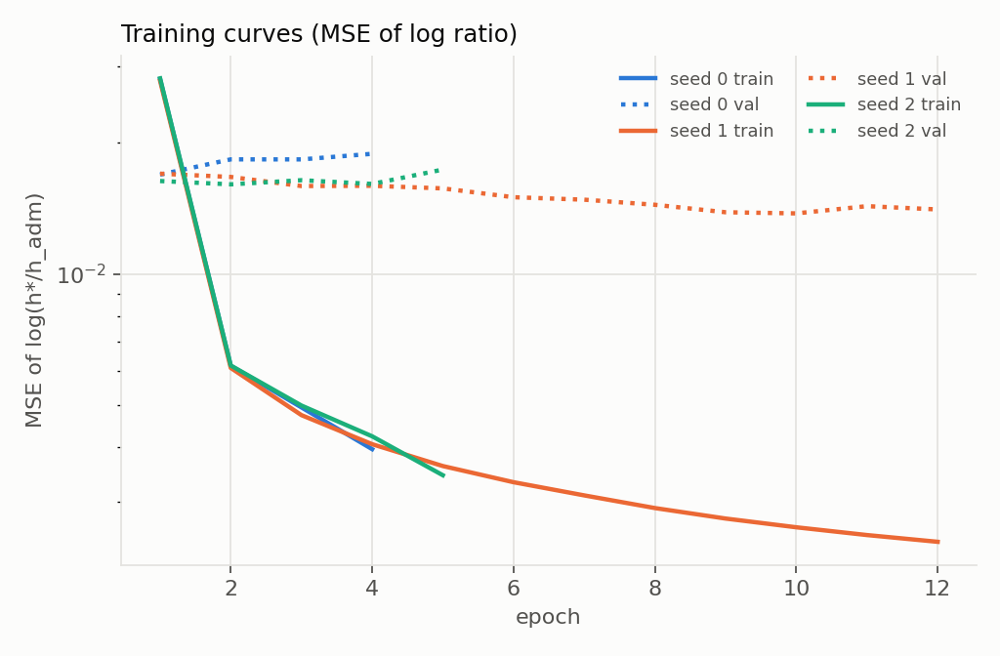
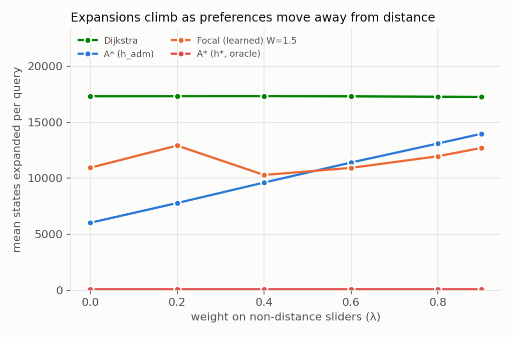
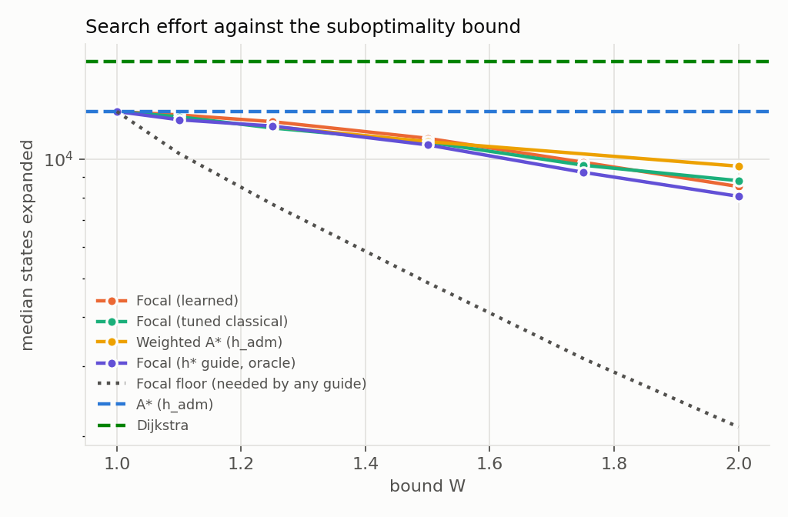
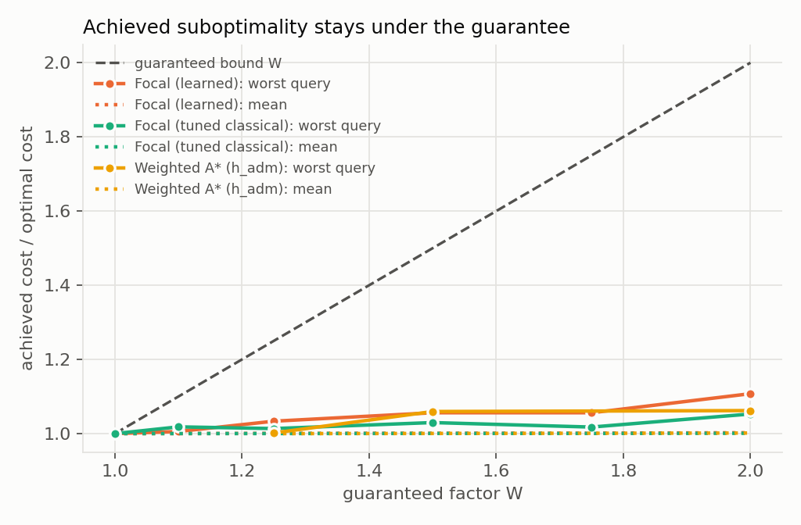
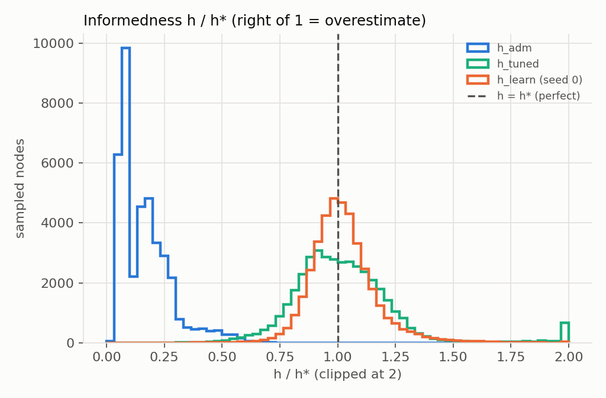
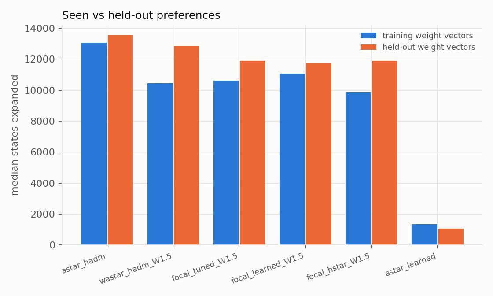
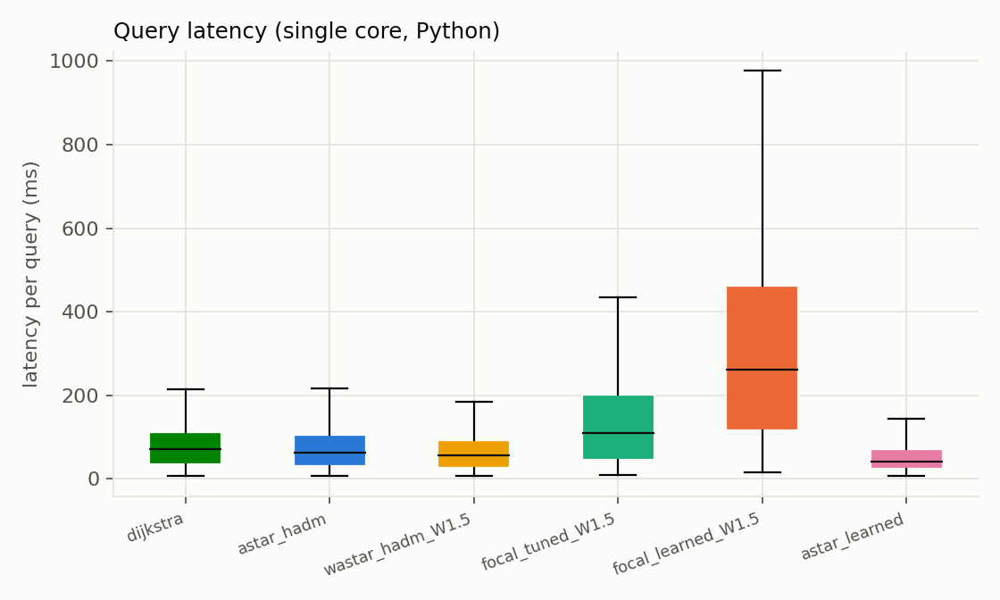

# Routes That Fit You

## A Personalised Multi-Objective Walking Route Planner with Learned Search Heuristics

**CS F407 Artificial Intelligence — Project Report**

**Team Wayfinder** · Track: Application (Search & Problem Solving + Applications of Deep Learning)

Vinny Polamarasetty · Soujanya Lakshmi Tayyala · Chandana N · Chaitanya Srikar Kastury ·
Anisha Potdar · Ananya Avunooru · Anushka Sahoo · Srujana N S

Repository: <https://github.com/ChaitanyaK07/WayFinder>

---

## Abstract

We built a walking route planner for the Jubilee Hills / Banjara Hills area of Hyderabad in which the user, not
the system, decides what matters. Five sliders weight walking time, junction load, traffic exposure, canopy
(tree-cover proximity) and climb. The planner returns the best route under those weights on a turn-aware graph of
13,246 nodes, 34,708 directed edges and 103,384 turn transitions built from OpenStreetMap, ESA WorldCover and the
Copernicus GLO-30 DEM.

We first measured the problem the proposal set out to study. As weight moves away from walking time, the
admissible distance heuristic weakens: A\* expansions rise from 35 % to 81 % of Dijkstra's. We then trained a
preference-conditioned neural heuristic on 8,000,000 exact labels from 8,000 backward Dijkstra runs. It is very
accurate: the mean ratio of predicted to true cost-to-go is 1.02, against 0.17 for the admissible heuristic, and
it is equally accurate on weight vectors never seen in training. Used directly in A\*, it expands 11× fewer states
than A\* with the admissible heuristic, but without any guarantee: routes are 4.4 % worse on average and up to
51 % worse.

Inside Focal Search, which guarantees a route within W × the optimum, the network does not pay off. All 7,000
bounded runs respected their guarantee. However, the learned guide saves only 15 % of expansions against A\* at
W = 1.5, about the same as weighted A\* and a tuned classical guide. Even a perfect guide saves only 18 %. We show
why: FOCAL admits a state only within W × f_min, and f_min is driven by the weak admissible heuristic. We measure
this with a per-query "focal floor". Following the proposal's Week-4 rule, the headline therefore falls back to
Focal Search with a tuned classical guide.

The delivered application returns the exact best route by default. This was verified on 147 random trips, with 0
violations of slider monotonicity in 735 checks. The human evaluation is fully prepared but was not run; Section 10
explains why and what can be concluded without it.

---

## 1. Introduction

### 1.1 Motivation

Mainstream route planners answer one question: what is the fastest way there? Many walking trips are not about
that. A student with a heavy bag will accept a few extra minutes to avoid a staircase. Someone recovering from a
knee injury routes around gradients. In a Hyderabad summer, walking under tree cover is worth a detour. These
preferences differ from person to person and from trip to trip, and no widely available tool lets a person state them.

### 1.2 Why this is technically hard

A\* beats Dijkstra by using a heuristic: an estimate of the remaining cost that pushes the search toward the goal.
For plain travel time, straight-line distance is a sound estimate. It never overestimates (admissibility), which
is what makes A\* return optimal routes. Once the cost also includes junction penalties, traffic exposure, canopy and
climb, a distance-based estimate stays admissible but becomes a weak guide, and A\* degenerates toward Dijkstra.
The stronger the user's non-distance preferences, the worse this gets — exactly when personalisation matters most.

### 1.3 What we did

1. A **turn-aware, five-objective cost model** on a real street graph, with every feature labelled *measured*,
   *derived* or *proxy* (Section 3–4).
2. An **admissible and consistent heuristic** whose consistency is guaranteed by construction, and checked on every
   edge (Section 4.3).
3. The **problem stated as a measurement**: expansions against non-distance weight (Section 9.1).
4. A **preference-conditioned learned heuristic**: one network for every slider setting, trained on exact labels from
   backward Dijkstra (Section 5).
5. **Focal Search** that uses the learned heuristic for guidance and the admissible heuristic for a provable
   `W ×` bound, with the bound verified for W = 1.0 … 2.0 against exact optima (Sections 6, 9.3).
6. An **evaluation** on 200 frozen queries with three training seeds, heuristic-quality analysis and
   generalisation to held-out preferences (Section 9).
7. A **routing service and web interface** with five sliders, verified to return the exact best route (Sections 7, 9.9).

The project makes no novelty claim. Its contribution is a ground-truth-verified evaluation of preference-conditioned
learned heuristics and Focal Search, including a negative result and the measurement that explains it.

---

## 2. Background

**Best-first search.** Dijkstra's algorithm expands states in order of path cost `g`. A\* (Hart, Nilsson and
Raphael, 1968) orders them by `f = g + h`, where `h` estimates the remaining cost. If `h` never overestimates
(*admissible*), A\* returns an optimal path. If `h(u) ≤ c(u, v) + h(v)` for every edge (*consistent*), A\* also never
needs to re-expand a state.

**Bounded suboptimality.** Weighted A\* orders by `g + W·h`. With a consistent `h` it returns a path of cost at most
`W ×` optimal. This guarantee depends on `h` being admissible; it does not hold for a learned, overestimating `h`.

**Focal Search** (Pearl and Kim, 1982) separates the two jobs of a heuristic. OPEN is ordered by a safe
`f = g + h_adm`. FOCAL is the subset of OPEN whose `f` is within `W ×` the current minimum. A second heuristic —
which may overestimate — decides which FOCAL state to expand next. The bound comes from the safe heuristic and the
guidance from the second one.

**Learned heuristics.** A network can learn the cost-to-go from examples. In our setting the labels are exact: one
backward Dijkstra run from a target gives the true optimal cost from every node. Conditioning the network on the
user's weight vector lets one model serve every slider setting.

**node2vec** (Grover and Leskovec, 2016) learns node embeddings from biased second-order random walks with a
skip-gram objective. Its return parameter `p` and in-out parameter `q` move the walks between breadth-first and
depth-first exploration.

---

## 3. Study area and data

### 3.1 Choosing the area: the coverage audit

Before writing the cost model we audited candidate areas (`results/audit/`, and the proposal's Section 3). Around the
BITS campus, OSM mapping was too sparse: no street names or stairways. Miyapur passed most checks, but canopy preference barely changed routes:
92 % overlap with the fastest route at weight 0.8 (`results/audit/comparison.csv`).

Jubilee Hills gave a working signal on every feature. On the final 7 × 7 km graph, a preference weight of 0.8:

- cut traffic exposure by 29 %, climb by 26 % and turns by 57 %;
- more than doubled canopy along the route;
- in each case at a mean detour of 12 % or less (`results/audit/jubilee_3500_verdict.csv`).

### 3.2 The graph

| Property | Value |
|---|---|
| Centre, extent | 17.4220 N, 78.4200 E; 7 × 7 km; UTM zone 44N (EPSG:32644) |
| Nodes / directed edges | 13,246 / 34,708 (largest strongly connected component = 100 % of nodes) |
| Turn-aware states / transitions | 34,708 / 103,384 |
| Network length (both directions) | 2,075 km |
| Elevation relief | 121 m |
| Stairway edges | 60 |

Source: `data/processed/graph_summary.json`. All data is open: OpenStreetMap (ODbL), ESA WorldCover 2021
(CC BY 4.0) and Copernicus GLO-30 DEM. We used no purchased data, API keys or scraping.

### 3.3 Features

Every feature is a per-metre score in [0, 1], except junction load, which is priced per turn. We label each one
honestly as measured, derived or proxy.

| Feature | Source | Status | Definition | Mean (length-weighted; junction: per transition) |
|---|---|---|---|---|
| Walking time | OSM highway class, length | measured | `0.5 / speed`; 1.3 m/s on footways … 0.5 m/s on steps | 0.42 |
| Junction load | node degree, way geometry | derived, exact | turn angle from bearings (<30° → 0, <75° → 0.3, <150° → 1, U-turn → 3), +0.2 at nodes with ≥ 3 neighbours | 1.61 |
| Traffic exposure | OSM highway class | proxy | ordinal rank: trunk/primary 1.0 … footway 0.0 | 0.39 |
| Canopy proximity | ESA WorldCover 2021, 10 m | proxy | `1 − tree-cover share` in a 15 m buffer | 0.91 |
| Climb | Copernicus GLO-30 DEM; `highway=steps` | derived, reliable | uphill grade clipped at 15 %, scaled to [0, 1]; stairs = 1 | 0.12 |

Source: `results/feature_summary.csv`.

**Why "canopy", not "shade".** Real shade modelling needs building heights and the sun's position. Building-height
tags in Hyderabad OSM are too sparse for that. What we can defensibly compute is proximity to tree cover. We call it
canopy proximity and label it a proxy: it correlates with shade but does not measure it. Likewise, OSM carries no
traffic counts, so traffic exposure is an ordinal ranking of road classes.

---

## 4. Problem formulation

### 4.1 Cost model

For a weight vector `w = (w_time, w_junction, w_traffic, w_canopy, w_climb)` with every slider in [0, 1]:

```
rho(e, w)          = 0.1 + Σ_k w_k · f_k(e)            k ∈ {time, traffic, canopy, climb}
c(e_in, e_out, w)  = length(e_out) · rho(e_out, w)  +  w_junction · 30 m · turn_penalty(e_in, e_out)
```

The base term 0.1 keeps every metre's cost above zero for every weight vector. Without it, the admissible
heuristic below would collapse to zero whenever all non-distance weights are zero on some edge. A penalty-1 turn
costs as much as 30 m of walking at full junction weight.

### 4.2 Turn-aware state space

A search state is the pair *(node, incoming edge)* — equivalently, the edge just walked. Transition `e → e'` exists
when `e'` leaves the node `e` enters, and it costs `c(e, e', w)`. The origin is a virtual state with no incoming
edge, so the first edge carries no turn cost. A query is solved when a state whose head is the destination is
expanded. U-turns are allowed (penalty 3) and self-loops (cul-de-sacs) are kept, so turning around is priced, not
forbidden.

### 4.3 The admissible heuristic, and why it is consistent

```
h_adm(v, t, w) = rho_min(w) · s · haversine(v, t),      rho_min(w) = min_e rho(e, w)
```

OSMnx measured edge lengths as sums of great-circle segments on a sphere of radius 6,371,009 m. We use haversine
on the same sphere. `s` is the smallest `length(e) / haversine(u, v)` over all edges, times `(1 − 10⁻⁹)` for
rounding; on our graph `s = 0.999999997`. Then for every edge `e = (u, v)` and any incoming state:

```
h_adm(u) ≤ rho_min · s · (haversine(u, v) + haversine(v, t))    triangle inequality
         ≤ length(e) · rho(e, w) + h_adm(v)                        definition of s, rho_min
         ≤ c(e_in, e, w) + h_adm(v)                                turn penalties ≥ 0
```

Since `h_adm(t) = 0`, `h_adm` is consistent and therefore admissible. The test suite checks this inequality on every
edge of the real graph, and the label pipeline checked `h_adm ≤ h*` on all 8,500,000 labelled samples: 0 violations
(`data/labels/labels_summary.json`).

---

## 5. The learned heuristic

### 5.1 Exact labels from backward Dijkstra

For a target `t` and weight vector `w`, one Dijkstra run on the *reversed* state graph gives `D(e)`: the optimal cost
from every state to `t`. The node-level label is the optimal cost of a route that *starts* at `v`:

```
H(v) = min over edges e' leaving v of [ cost(e') + D(e') ],      H(t) = 0
```

Turn penalties are non-negative, so `H(head(e)) ≤ D(e)`. A node-level heuristic trained on `H` therefore targets a
lower bound of the true state cost-to-go.

The 8,000 backward runs (40 weight vectors × 200 targets) use SciPy's compiled Dijkstra and take about one to two
minutes on one core. The test suite cross-checks them against a pure-Python reference implementation. From each run
we keep 1,000 uniformly sampled nodes; every label is exact, and sampling only bounds the dataset size.

**The published dataset** (`data/labels/`, described in `DATASHEET.md`):

| Folder | Weight vectors | Targets | Runs | Samples |
|---|---|---|---|---|
| `train_weights/` | 40 training | all 200 | 8,000 | 8,000,000 |
| `heldout_weights/` | 10 held-out | 50 (val + test) | 500 | 500,000 |

Each folder holds one compressed shard per weight vector (`w00.npz` …, about 3.4 MB each) and an `index.json` with
the weight vectors and a SHA-256 per shard, which is checked whenever the labels are loaded.

### 5.2 Weight vectors and splits

The weight vectors are frozen once in `data/splits/weights.json`: 40 for training and 10 held out. Each slider is
drawn uniformly from [0, 1] and switched off with probability 0.3, to cover sparse preferences.

The 200 label targets are frozen in `data/splits/targets.json` and split **by target node**: 150 train, 25
validation, 25 test. The model therefore never sees a test destination, and never sees a held-out weight vector
while training or choosing hyperparameters.

### 5.3 Inputs: node2vec embeddings

We implemented node2vec from scratch. It uses second-order biased walks (`p = 1`, `q = 0.5`; 10 walks of length 40
per node, 132,460 walks in total), vectorised over all walks at once. Training is skip-gram with 5 negative samples
(window 5) for 2 epochs, with the loss falling from 0.220 to 0.095, giving 32-dimensional embeddings
(`data/processed/node2vec.json`).

### 5.4 Network and ratio parameterisation

```
x       = [ node2vec(v), node2vec(t), w, (Δx, Δy, ‖Δ‖) / 1 km ]   32 + 32 + 5 + 3 = 72 inputs
r_hat   = 1 + softplus( MLP(x) )                                 MLP: 72 → 256 → 256 → 1, ReLU
h_learn = r_hat · h_adm(v, t, w)
```

The network predicts the *ratio* of the true cost to `h_adm`, not the cost itself. Since `r_hat ≥ 1`, `h_learn` is
never less informed than the classical heuristic, and the target ratio `h*/h_adm` is scale-free across weight
vectors. The loss is the mean squared error of `log r_hat` against `log(h*/h_adm)`.

### 5.5 Training

We used Adam with batches of 4,096, halved the learning rate when validation stalled, and stopped early with
patience 3, checkpointing the best epoch. A hyperparameter pass over hidden size × learning rate, on 1.5 M samples
for 3 epochs, chose 256 × 256 at lr = 0.003:

| Hidden | Learning rate | Validation MSE (log ratio) |
|---|---|---|
| 256, 256 | 0.003 | **0.0155** |
| 128, 128 | 0.003 | 0.0165 |
| 128, 128 | 0.001 | 0.0181 |
| 256, 256 | 0.001 | 0.0182 |

Three seeds were then trained on all 6,000,000 training-target samples. Their best validation MSEs were 0.0169,
0.0138 and 0.0161, at epochs 1, 10 and 2 (`results/training/`). The training loss keeps falling while the validation
loss stalls early, which shows that generalising to *unseen destinations* is the hard part with only 150 training targets.



### 5.6 Batched inference with cached embeddings

The first layer is linear, so `W₁x` splits into a node term, a target term, a weight term and an offset term. The
node and target terms are precomputed once for every node (the cached embeddings), and the weight and target terms
once per query. Only the 3-number offset and the remaining layers run per node, in numpy.

When the search first meets a node, the whole 250 m spatial tile containing it is inferred in one batch, so only the
region the search actually touches is computed. A test checks that this numpy port agrees with PyTorch.

### 5.7 Tuned classical fallback

The proposal's Week-4 fallback needs a strong *classical* guide. We fitted `h_tuned = κ(w) · h_adm`, with
`log κ` linear in `w`, by least squares on the training labels. It uses no node information, so it is a tuned version
of the classical heuristic rather than a learned one (`models/tuned_classical.json`).

---

## 6. Search algorithms

All searches run on the turn-aware state graph and count states **expanded** (taken off OPEN; the origin counts
as one) and **generated** (inserted into OPEN, new or with a better `g`).

**Dijkstra, A\*, weighted A\*.** One best-first search ordered by `g + W·h`, breaking ties toward larger `g`. With
the consistent `h_adm`, A\* never re-expands and weighted A\* keeps its `W ×` bound without re-expansions.

**Focal Search.** OPEN is ordered by `f = g + h_adm`. FOCAL holds OPEN states with `f ≤ W · f_min`. The next state is
the FOCAL state with the smallest `g + h_learn`. The implementation keeps three heaps with lazy deletion and per-state
version stamps. When `f_min` rises, states move from a waiting heap into FOCAL, and a FOCAL entry found above the
current bound is moved back. Re-opening is on.

**Why the bound holds.** With re-opening, some state on an optimal path is always on OPEN with its optimal `g`, so
`f_min ≤ C*`. A goal is only ever taken from FOCAL, where `g = f ≤ W · f_min ≤ W · C*`.

**Focal floor.** For every query and W we also count the states with `g* + h_adm < C*/W`, using a forward Dijkstra.
Focal Search stops only once `f_min ≥ C*/W`, and with re-opening each such state keeps a lower-`f` state on OPEN
until it is expanded. So **every** Focal Search must expand all of them, whatever its guide. The test suite checks
this lower bound for perfect and adversarial guides.

The tests also run Focal Search with a random, wildly inadmissible guide at W ∈ {1.0, 1.1, 1.5, 2.0}: the bound
always holds, and W = 1.0 is always exactly optimal.

---

## 7. System

* **Pipeline** (`python -m wayfinder <step>`): preprocess → splits → benchmark → labels → node2vec → train →
  evaluate → report → study-prepare / study-analyze. Each step only reads and writes files. Splits and benchmark are
  frozen and refuse to be overwritten. All settings live in `configs/default.yaml`.
* **Routing service** (FastAPI): `POST /api/route` takes an origin, a destination and the five weights, snaps the
  points to the network, searches, and returns the route geometry, its metrics, search statistics and the fastest
  route for comparison. Route pricing is cached per weight vector, behind a lock, because requests arrive on a
  thread pool.
* **Web interface** (Leaflet): click a start and a destination, then drag five horizontal sliders or pick a preset.
  The route updates as you drag, and only the newest request may draw, so a slow earlier reply cannot overwrite it.
  **By default the search is exact (A\*)**: the displayed route is the best possible route for the chosen sliders.
  Focal Search and weighted A\* are opt-in modes labelled "within W × best".
* **Tests:** 87 tests, run on a synthetic fixture graph and on the real graph (Section 12).

---

## 8. Experimental setup

* **Benchmark:** 200 queries frozen with a fixed seed (`data/benchmark/queries.csv`, with a SHA-256 checked on every
  load). Origin and destination are at least 700 m apart (median 3.4 km, max 7.7 km), and no destination is a label
  target. 100 queries use a training weight vector and 100 a held-out one.
* **Ground truth:** the exact optimum of every query, from backward Dijkstra.
* **Conditions:**
    - Dijkstra; A\*(h_adm); weighted A\* at W = 1.25, 1.5, 2;
    - A\*(h\*) (oracle);
    - A\*(h_learn) (no bound);
    - Focal Search guided by h_learn, by h_tuned and by h\* (oracle), each at W = 1.0, 1.1, 1.25, 1.5, 1.75, 2.0.
    - Learned conditions are run with all three seeds (7,800 runs in total).
* **Metrics:**
    - states expanded and generated;
    - latency (graph pricing + heuristic preparation + search, one process);
    - suboptimality (cost / exact optimum) and bound violations;
    - heuristic admissibility violations, consistency violations and informedness `h/h*`.
* **Hardware:** a laptop CPU, single-threaded Python, no GPU.

---

## 9. Results

### 9.1 The problem, stated as a measurement

The λ family `w = (1 − λ, λ/4, λ/4, λ/4, λ/4)` moves weight from walking time to the four other sliders. This is
on the 200 frozen origin–destination pairs (`results/problem_curve.csv`):

| λ | rho_min | Dijkstra | A\*(h_adm) | A\*(h_adm) / Dijkstra | h_adm / h\* at origin | A\*(h\*) |
|---|---|---|---|---|---|---|
| 0.0 | 0.485 | 17,316 | 6,026 | **0.35** | 0.67 | 87 |
| 0.2 | 0.408 | 17,321 | 7,787 | 0.45 | 0.56 | 85 |
| 0.4 | 0.331 | 17,324 | 9,617 | 0.56 | 0.46 | 84 |
| 0.6 | 0.254 | 17,311 | 11,404 | 0.66 | 0.35 | 84 |
| 0.8 | 0.177 | 17,286 | 13,105 | 0.76 | 0.25 | 85 |
| 0.9 | 0.138 | 17,272 | 13,974 | **0.81** | 0.19 | 85 |

(mean states expanded per query)



As preferences move away from distance, `rho_min` falls, `h_adm` recovers less and less of the true cost (67 % → 19 %),
and A\* drifts toward Dijkstra. The perfect heuristic would need about 85 expansions throughout, so the headroom a
better heuristic could in principle exploit grows from about 70× at λ = 0 to about 160× at λ = 0.9. The figure also
shows learned Focal Search at W = 1.5: at low λ it expands *more* than A\*, and it never comes close to the
headroom. Section 9.8 explains why.

### 9.2 Search efficiency on the frozen benchmark

Medians over the 200 queries; learned conditions pool three seeds (`results/benchmark_summary.csv`):

| Condition | W | Expanded (median) | IQR | Focal floor | Latency median / p95 (ms) | Mean / max suboptimality |
|---|---|---|---|---|---|---|
| Dijkstra | – | 17,574 | 6,975 – 26,970 | – | 72 / 178 | 1 / 1 |
| A\*(h_adm) | 1 | 13,168 | 5,398 – 22,265 | – | 63 / 183 | 1 / 1 |
| Weighted A\* | 1.5 | 11,054 | 4,847 – 20,154 | – | 56 / 184 | 1.000 / 1.060 |
| Weighted A\* | 2 | 9,586 | 3,701 – 17,817 | – | 51 / 176 | 1.002 / 1.062 |
| Focal, tuned classical | 1.5 | 11,029 | 4,616 – 19,134 | 4,877 | 109 / 379 | 1.000 / 1.030 |
| Focal, tuned classical | 2 | 8,812 | 3,749 – 16,921 | 2,110 | 90 / 395 | 1.001 / 1.053 |
| **Focal, learned** | 1.5 | 11,161 | 4,619 – 19,252 | 4,877 | 261 / 783 | 1.001 / 1.056 |
| **Focal, learned** | 2 | 8,552 | 3,555 – 17,619 | 2,110 | 204 / 726 | 1.002 / 1.108 |
| Focal, perfect guide h\* (oracle) | 1.5 | 10,847 | 4,270 – 18,260 | 4,877 | 110 / 340 | 1 / 1 |
| Focal, perfect guide h\* (oracle) | 2 | 8,049 | 2,820 – 15,530 | 2,110 | 76 / 304 | 1 / 1 |
| **A\*(h_learn), no bound** | – | **1,205** | 402 – 2,351 | – | **40** / 144 | 1.044 / 1.506 |
| A\*(h\*) (oracle) | 1 | 84 | 54 – 112 | – | 6 / 11 | 1 / 1 |

Per-seed medians for learned Focal at W = 1.5 are 11,285.5, 11,060 and 11,269, and for A\*(h_learn) 1,340,
1,031.5 and 1,177.5. The seeds agree closely.



### 9.3 The suboptimality bound holds

Across all 7,000 bounded runs (every Focal condition, every W, three seeds, plus weighted A\* and A\*), **no route
exceeded its guaranteed bound** (`results/bound_sweep.csv`). In practice the routes are far better than guaranteed.
For learned Focal, the worst query was 1.006×, 1.033×, 1.056×, 1.056× and 1.108× the optimum at
W = 1.1, 1.25, 1.5, 1.75 and 2.0, and the mean stayed within 0.2 % of optimal.



### 9.4 Heuristic quality

Averaged over the 200 benchmark queries, at 2,000 sampled nodes each (`results/heuristic_quality.csv`):

| Heuristic | h / h\* mean (median) | Overestimates h\* | Mean overestimate | Consistency violations |
|---|---|---|---|---|
| h_adm | 0.167 (0.168) | 0 % | 0 % | 0 % |
| h_tuned | 1.029 (1.038) | 50.2 % | 13.3 % | 24.3 % |
| h_learn, seed 0 | 1.024 (1.014) | 53.5 % | 10.7 % | 32.7 % |
| h_learn, seed 1 | 1.031 (1.019) | 55.5 % | 10.4 % | 31.8 % |
| h_learn, seed 2 | 1.022 (1.009) | 51.2 % | 10.6 % | 33.2 % |



The learned heuristic recovers essentially the whole true cost: its median `h/h*` is within 2 % of 1. It
overestimates about half the time, by about 10 % on average, which is why it needs Focal Search's safety net. Its
spread is tighter than the tuned classical heuristic's. The tuned heuristic is surprisingly good *on average*,
because one scalar κ(w) per weight vector already captures the typical detour ratio, but it is wider: its histogram
has a long right tail.

### 9.5 Generalisation to held-out preferences

On label level, for unseen test targets (median over seeds; `results/training/label_metrics.csv`):

| | MAE of log(h\*/h_adm) | h_learn / h\* | h_adm / h\* |
|---|---|---|---|
| training weight vectors | 0.100 | 1.041 | 0.211 |
| **held-out weight vectors** | 0.104 | 1.013 | 0.117 |

On search level, the median expanded states split by weight set (`results/generalisation.csv`): A\*(h_learn) needs
1,068 on held-out weights against 1,340 on training weights. Learned Focal at W = 1.5 needs 11,726 against 11,065.

The network **generalises rather than memorises**: its accuracy on preferences it never saw matches the training
preferences. The held-out queries are harder for the classical heuristic, whose informedness drops to 0.117, but not
for the learned one.



### 9.6 Latency

All conditions run in single-threaded Python and are interactive (`results/plots/latency.png`). A\*(h_adm) has a
median of 63 ms. A\*(h_learn) is the fastest practical option at 40 ms, because it expands 11× fewer states. Learned
Focal is the slowest, at 261 ms median and 783 ms p95: it pays for network inference *and* expands as many states as
A\*.



### 9.7 Week-4 go / no-go

The proposal's gate asks whether the learned heuristic expands fewer nodes than the classical baseline. We applied it
strictly: GO requires beating both A\*(h_adm) and the tuned classical guide at the same W
(`results/go_no_go.json`).

* Learned Focal against A\*(h_adm) at W = 1.5: 11,161 vs 13,168, **15.2 % fewer** ✔
* Learned Focal against tuned Focal at W = 1.5: 11,161 vs 11,029 ✘
* Learned Focal against weighted A\* at W = 1.5: 11,161 vs 11,054 ✘

**Verdict: NO-GO.** Following the proposal's fallback, the headline method is Focal Search guided by the tuned
classical heuristic, and the rest of this section is the measurement of why the learned version did not pay off.

### 9.8 Why Focal Search cannot exploit a good heuristic

The learned heuristic is excellent (Section 9.4), and A\* with it is 11× cheaper. Yet inside Focal Search it barely
helps — and **neither does a perfect heuristic**. Focal Search guided by the true `h*` saves only 17.6 % at W = 1.5.

The reason is structural. A goal can only be taken from FOCAL once `f_min ≥ C*/W`, and `f_min` is the minimum of
`g + h_adm` over OPEN. With `h_adm` recovering only 17 % of the true cost, the region of states with
`g + h_adm < C*/W` is large, and every one of those states must be expanded before the search can stop.

At W = 1.5 this **focal floor** is 4,877 states (median). The observed expansions are above 10,800 for *every*
guide, because the guide spends expansions on near-optimal states while `f_min` still has to be raised.

Two practical consequences follow:

- The guarantee of Focal Search is only as useful as its admissible heuristic. Better guidance cannot buy speed
  until `h_adm` itself is stronger, for example with ALT landmarks (Goldberg and Harrelson, 2005), which the
  proposal placed out of scope.
- Where a guarantee is not required, the learned heuristic in plain A\* gives most of the possible gain. It cuts
  expansions 11×, keeps routes within 4.4 % of optimal on average, and reaches 51 % worse only in the worst query.

We also piloted a bound-preserving "incumbent" FOCAL policy, which switches to the `f_min` state once a goal has been
generated. On eight benchmark queries it saved at most about 3 %, so we removed it: the extra expansions happen
*before* the goal is ever generated.

### 9.9 The application returns the best route

`scripts/verify_routes.py` drew 147 random trips with random slider settings on the real graph. Every route the
application returned by default equalled the exact Dijkstra optimum, both by its reported cost and when re-priced
from its edges (**147/147**, worst ratio 1.000000000000).

For an exact optimiser, raising one slider cannot increase the route's total of what that slider penalises. We
checked this for all five sliders on every trip: **0 violations in 735 checks**. Moving each slider from 0 to 1
changed the route in 106 (time), 141 (junction), 136 (traffic), 129 (canopy) and 115 (climb) of the 147 trips.

---

## 10. Human evaluation

### 10.1 What the proposal planned

Backward Dijkstra proves that a route is optimal for the cost function *we wrote down*. It says nothing about whether
that cost function reflects what a person would actually choose. The proposal's Section 4 therefore planned a small
study. For twelve real origin–destination pairs, participants would see the fastest route and the route under one of
three stated preference profiles, unlabelled and in random order, with a short scenario. They would pick the one they
would take. The proposal planned about twenty-five participants, reports agreement per profile, and explicitly makes
no claim of statistical significance.

### 10.2 What is ready

Everything except the participants:

* **Three profiles**, each with a written scenario:
    - *shade*: time 0.2, canopy 0.8;
    - *quiet*: time 0.2, traffic 0.8;
    - *easy*: time 0.2, climb 0.8, junction 0.4.
* **Twelve trials** (`data/user_study/trials.json`), four per profile. Each pair lies within 2.5 km of the study-area
  centre. It was chosen so that the profile route is clearly different from the fastest route (overlap ≤ 0.5), costs
  at most a 15 % detour, and improves its target property by at least 20 %. Endpoints are described by the nearest
  named street.
* **A study page** (`/study`): routes are shown as "Route A" / "Route B". The order is counterbalanced: each route is
  shown first in exactly half of the trials, in shuffled positions, so no participant can see one route first throughout.
  Each answer stores the participant code, the trial, the choice and which route was shown first. Responses are kept
  out of the repository (`.gitignore`), and `python -m wayfinder study-analyze` produces the agreement table.

### 10.3 Status

**The study was not conducted for this submission, and we report no agreement rate.** Recruiting twenty-five
participants was not feasible in the time available, and we did not simulate or invent responses. The study can be
run at any smaller size — for example the eight team members plus a few classmates, about five minutes each. The
proposal already avoids significance claims, so the results would then be reported with their participant count.

### 10.4 What can be said without participants

The trials themselves give an *objective* (non-human) check that each profile route does what its scenario asks,
at a modest cost (`data/user_study/trials.csv`):

| Profile | Trials | Mean overlap with fastest | Mean detour | Mean improvement of the target property |
|---|---|---|---|---|
| shade | 4 | 0.33 | 8.5 % | canopy along the route +181 % |
| quiet | 4 | 0.35 | 7.0 % | traffic exposure −29 % |
| easy | 4 | 0.39 | 7.7 % | effort score per km (climb + ½ · stairs length + turn load) −32 % |

This shows that the cost function *can express* each preference with real, moderate trade-offs. Whether people
*agree* with these trade-offs remains untested, and all weight combinations beyond the three profiles are
algorithmically correct but behaviourally untested.

---

## 11. Discussion and limitations

**What worked.**

- The cost model gives a real signal on every slider.
- The admissible heuristic is provably consistent.
- Exact labels make learning easy to evaluate.
- The preference-conditioned network is accurate and generalises to unseen preferences.
- Focal Search's bound held in every one of 7,000 runs.
- The application returns provably best routes interactively.

**What did not.** The proposal's headline — learned guidance making bounded-suboptimal search substantially faster —
did not materialise. The cause is not the network but the search framework: Focal Search's effort is set by the
admissible OPEN heuristic. We consider the focal-floor measurement, together with the perfect-guide control, the main
technical finding of the project.

**Threats to validity and limitations.**

* *Proxies.* Traffic exposure is ranked from road class, not measured. Canopy is tree-cover proximity, not shade.
  The climb score inherits 30 m DEM noise; grades are clipped at 15 % for that reason.
* *One study area.* All results are on one 7 × 7 km graph. The coverage audit shows that sparse OSM areas such as
  the BITS campus would behave differently.
* *Generalisation to destinations.* With 150 training targets, validation loss stalls after a few epochs. More
  targets would likely tighten the learned heuristic further.
* *Latency* is measured in single-threaded Python. The relative order of conditions is what matters; absolute times
  would fall several-fold in a compiled implementation.
* *No human evaluation* yet (Section 10).

**Future work.**

- A stronger admissible bound for OPEN, such as ALT landmarks or the max of several admissible estimates, so that
  Focal Search can use its guide.
- Explicit Estimation Search, which uses an inadmissible estimate to decide *when* to raise `f_min`.
- Training against an admissible ceiling, to trade a little informedness for fewer overestimates.
- Running the user study.

---

## 12. Reproducibility

Everything needed is in the repository. That includes the graph, frozen splits and benchmark, the label dataset,
embeddings, trained models and every result file.

```bash
python -m pip install -r requirements-dev.txt && python -m pip install -e . --no-deps
python -m pytest                       # 87 tests: fixture graph + real graph
python scripts/verify_routes.py        # 147 random trips: exact routes, slider monotonicity
python -m wayfinder serve              # web app at http://127.0.0.1:8000
python -m wayfinder all                # whole pipeline from the GraphML (~1.5 h on a laptop CPU)
```

| Step | Time |
|---|---|
| Labels (8,000 runs) | 1–2 min |
| node2vec | ~4 min |
| Training (hyperparameter pass + 3 seeds) | 25–40 min |
| Evaluation | 40–50 min |

Every number in Section 9 is copied from a file under `results/`. `python -m wayfinder report` regenerates
`results/summary.md` and all figures from the raw result files.

---

## Appendix A — Work division

| Pair | Build phase (Weeks 1–4) | Second phase (Weeks 5–7) | Members |
|---|---|---|---|
| Graph | OSM extraction, coverage audit, UTM projection, turn-aware graph, five feature extractors, cost model | routing service (FastAPI), web interface with sliders | Anisha Potdar, Ananya Avunooru |
| Search | Dijkstra, A\*, weighted A\*, admissible heuristic, turn-aware expansion, node accounting, batched inference | Focal Search, W sweep, empirical bound verification | Srujana N S, Anushka Sahoo |
| Data | backward Dijkstra at scale, weight-vector sampling, label pipeline, dataset publication, node2vec | evaluation harness, heuristic-quality analysis, plots | Soujanya Lakshmi Tayyala, Chandana N |
| Model | network architecture, ratio parameterisation, training loop, hyperparameter pass, checkpointing | generalisation on held-out weights, user study | Vinny Polamarasetty, Chaitanya Srikar Kastury |

## Appendix B — AI-usage disclosure

The implementation, tests, evaluation runs and this report were produced with the help of an AI coding assistant
(Claude Code), as logged in `docs/ai_usage_log.md`. Every claim is backed by a result file and every algorithm by
tests against exact optima. Each pair is responsible for being able to explain its components in the viva.

## Appendix C — Main settings (`configs/default.yaml`)

| Setting | Value |
|---|---|
| Weight vectors | 40 training + 10 held-out; slider off with probability 0.3; seed 7 |
| Label targets | 200 (150 / 25 / 25 by target); 1,000 nodes kept per run |
| Benchmark | 200 queries, ≥ 700 m apart, half on held-out weights; seed 2025 |
| node2vec | 32-d, p = 1, q = 0.5, 10 walks × 40 steps, window 5, 5 negatives, 2 epochs |
| Network | 72 → 256 → 256 → 1, ReLU, `r_hat = 1 + softplus` |
| Training | Adam, lr 0.003, batch 4,096, ≤ 12 epochs, patience 3, seeds 0, 1, 2 |
| Evaluation | Focal W ∈ {1.0, 1.1, 1.25, 1.5, 1.75, 2.0}; weighted A\* W ∈ {1.25, 1.5, 2}; FOCAL key `g + h_learn`; headline W = 1.5 |

## References

1. Hart, P. E., Nilsson, N. J., Raphael, B. (1968). A Formal Basis for the Heuristic Determination of Minimum Cost
   Paths. *IEEE Transactions on Systems Science and Cybernetics*, 4(2), 100–107.
2. Pearl, J., Kim, J. H. (1982). Studies in Semi-Admissible Heuristics. *IEEE TPAMI*, 4(4), 392–399.
3. Goldberg, A. V., Harrelson, C. (2005). Computing the Shortest Path: A\* Search Meets Graph Theory. *SODA 2005*.
4. Boeing, G. (2017). OSMnx: New Methods for Acquiring, Constructing, Analyzing, and Visualizing Complex Street
   Networks. *Computers, Environment and Urban Systems*, 65, 126–139.
5. Grover, A., Leskovec, J. (2016). node2vec: Scalable Feature Learning for Networks. *KDD 2016*.
6. Russell, S., Norvig, P. (2020). *Artificial Intelligence: A Modern Approach*, 4th ed., Chapters 3–4 and 22.
